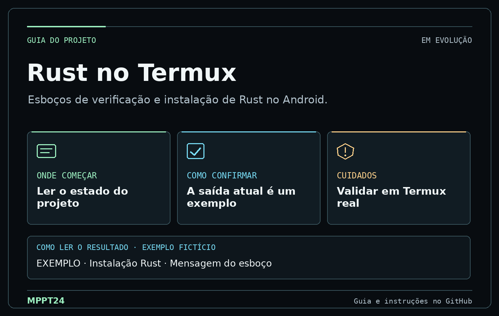

# Guia de Rust no Termux

**Estado:** Em evolução.

Esboços de verificação e instalação de Rust no Android.

[](docs/guia-visual.png)

## Onde começar

Abre o [README](README.md) e confirma que estás no projeto para Termux.

## Como confirmar

Os scripts públicos só imprimem mensagens. Ainda não há um teste funcional de instalação.

## Como ler os registos

Não existe um registo validado de instalação nesta versão. O texto do terminal mostra apenas qual o esboço executado.

### Exemplo fictício

```text
EXEMPLO · Instalação Rust · Mensagem do esboço
```

Lê pela ordem **resultado**, **etapa** e **detalhe**. Para investigar uma falha, confirma primeiro a data e a versão, depois abre o primeiro passo que falhou.

## Cuidados

Valida uma futura versão em Termux antes de a disponibilizar. Usa dados de exemplo ao descrever o dispositivo.
